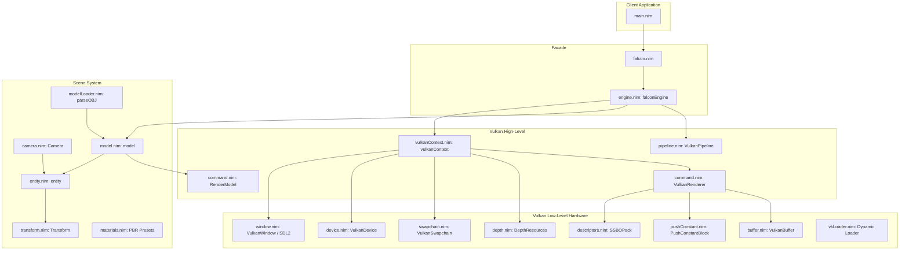
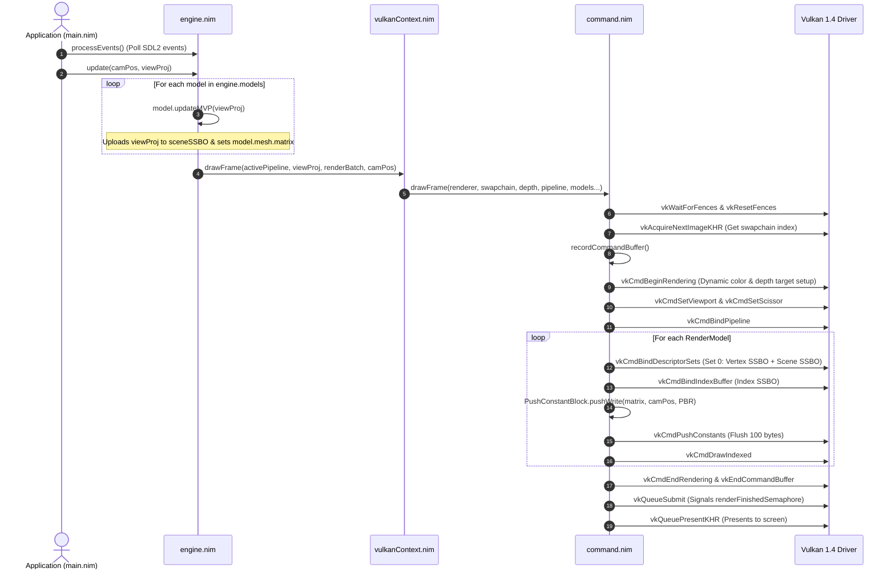

# Falcon Engine — Core Architecture & API Reference (`src/`)

Welcome to the internal and API reference manual for the **Falcon** 3D game engine. This document is written for both **human developers** (engine contributors, game developers) and **AI language models / autonomous agents** (pair programmers, code generators).

---

## Table of Contents
1. [Executive Summary & Design Philosophy](#executive-summary--design-philosophy)
2. [Quickstart & Minimal Working Examples](#quickstart--minimal-working-examples)
   - [Prerequisites & Build Instructions](#prerequisites--build-instructions)
   - [Basic Render Application](#basic-render-application)
   - [Spawning Custom Procedural Meshes](#spawning-custom-procedural-meshes)
3. [System Architecture](#system-architecture)
   - [High-Level Component Hierarchy](#high-level-component-hierarchy)
   - [Frame Execution & Data Flow](#frame-execution--data-flow)
4. [Critical Contracts for AI Models & Developers](#critical-contracts-for-ai-models--developers)
   - [Contract 1: Programmable Vertex Pulling (SSBOs)](#contract-1-programmable-vertex-pulling-ssbos)
   - [Contract 2: 100-Byte Push Constant Memory Layout](#contract-2-100-byte-push-constant-memory-layout)
   - [Contract 3: Coordinate Systems & Matrix Invariants](#contract-3-coordinate-systems--matrix-invariants)
   - [Contract 4: Dynamic Rendering (Vulkan 1.4)](#contract-4-dynamic-rendering-vulkan-14)
   - [Contract 5: Object Ownership & Lifecycle](#contract-5-object-ownership--lifecycle)
5. [Comprehensive Module Reference](#comprehensive-module-reference)
   - [Engine & Orchestration (`engine.nim`, `falcon.nim`)](#engine--orchestration-enginenim-falconnim)
   - [Entities & Math (`entity.nim`, `transform.nim`, `camera.nim`, `model.nim`)](#entities--math-entitynim-transformnim-cameranim-modelnim)
   - [Asset Ingestion (`modelLoader.nim`, `builtins.nim`)](#asset-ingestion-modelloadernim-builtinsnim)
   - [Materials & Shading (`materials.nim`, `pushConstant.nim`)](#materials--shading-materialsnim-pushconstantnim)
   - [Renderer & Commands (`command.nim`, `pipeline.nim`)](#renderer--commands-commandnim-pipelinenim)
   - [Vulkan Core (`vulkanContext.nim`, `device.nim`, `swapchain.nim`, `depth.nim`, `buffer.nim`, `descriptors.nim`)](#vulkan-core-vulkancontextnim-devicenim-swapchainnim-depthnim-buffernim-descriptorsnim)
   - [Platform & Loader (`window.nim`, `vkLoader.nim`, `helper.nim`)](#platform--loader-windownim-vkloadernim-helpernim)
6. [Shader Specification & PBR Implementation](#shader-specification--pbr-implementation)
7. [Compilation Flags & Optimization Recipes](#compilation-flags--optimization-recipes)

---

## Executive Summary & Design Philosophy

Falcon is an explicit, modern 3D game engine backend written in **Nim 2.0+** using **Vulkan 1.4** (via `vk14`), **SDL2**, and **cglm**.

Key architectural tenets:
1. **Modern Vulkan 1.4 Dynamic Rendering**: Eliminates legacy `VkRenderPass` and `VkFramebuffer` overhead. Render targets and depth attachments are bound dynamically per-frame via `vkCmdBeginRendering`.
2. **Programmable Vertex Pulling via SSBOs**: Meshes avoid fixed-function Vulkan vertex input state (`vertexBindingDescriptionCount = 0`). Vertex arrays reside in Storage Buffer Objects (SSBOs, binding 0) and are indexed in shaders using `gl_VertexIndex`.
3. **Data-Oriented Push Constant Streaming**: Model transformations, camera coordinates, and full PBR material parameters are serialized sequentially into a tightly packed 100-byte stream directly flushed through `vkCmdPushConstants` (max budget: 128 bytes).
4. **Lightweight Entity-Component Architecture**: Models and cameras inherit from `entity`, exposing composable `Transform` components with clean vector manipulation APIs.
5. **Zero Dynamic Link Overhead**: Uses a custom runtime function loader (`vkLoader.nim`) driven by SDL2's instance proc resolver, providing seamless cross-platform driver compatibility and KHR fallbacks.

---

## Quickstart & Minimal Working Examples

### Prerequisites & Build Instructions

Ensure the following tools and packages are installed:
- **Nim 2.0+** compiler
- **Vulkan SDK 1.4+** (with `glslc` on `$PATH`)
- **SDL2** development libraries (e.g., `libsdl2-dev` on Debian/Ubuntu)
- Nim packages: `nimble install vk14 sdl2 cglm`

Compile the GLSL shaders to SPIR-V:
```sh
glslc shaders/basic.vert -o shaders/vert.spv
glslc shaders/basic.frag -o shaders/frag.spv
```

Run in development mode:
```sh
nim c -r main.nim
```

---

### Basic Render Application

The following complete sample demonstrates how to initialize Falcon, load an `.obj` model, configure a camera, create a pipeline, and run the update loop:

```nim
import falcon

# 1. Initialize Engine & Window
var fg = newEngine("Falcon Engine Showcase", 1280, 720)

# 2. Parse & Format 3D Geometry
# parseOBJ extracts raw vertex floats & indices; .format() converts them to GPUVertex
var cubeModel = parseOBJ("cube.obj").format()

# 3. Setup Camera & Graphics Pipeline
var cam = newCamera(
  pos = [0.0'f32, 1.0'f32, 5.0'f32],
  fov = 0.785398'f32, # ~45 degrees
  aspectRatio = 1280.0'f32 / 720.0'f32
)
discard fg.createPipeline("shaders/vert.spv", "shaders/frag.spv")

# 4. Spawn Model Entities in World Space
var cubeLeft  = fg.spawnModel(cubeModel, pos = [-1.5'f32, 0.0'f32, -2.0'f32])
var cubeRight = fg.spawnModel(cubeModel, pos = [ 1.5'f32, 0.0'f32, -2.0'f32])

# 5. Main Game Loop
while fg.running:
  fg.processEvents()

  # Rotate models independently
  cubeLeft.transform.rotateY(speed(1.5))
  cubeRight.transform.rotateX(speed(-1.0))

  # Calculate camera View-Projection matrix
  let viewProj = cam.getViewProjectionMatrix()

  # Update transforms, upload SSBO scene matrices, and submit draw calls
  fg.update(cam.transform.pos, viewProj)

# 6. Graceful Destruction
fg.destroy()
```

---

### Spawning Custom Procedural Meshes

In addition to loading `.obj` files, models can be spawned from raw `GPUVertex` and `uint32` index arrays:

```nim
import falcon

var fg = newEngine("Procedural Mesh Example", 800, 600)
var cam = newCamera(pos = [0.0'f32, 0.0'f32, 3.0'f32])
discard fg.createPipeline("shaders/vert.spv", "shaders/frag.spv")

# Define 3 vertices for a single triangle (counter-clockwise winding)
let triangleVertices = [
  GPUVertex(
    pos:    [ 0.0'f32, -0.5'f32, 0.0'f32, 1.0'f32],
    color:  [ 1.0'f32,  0.0'f32, 0.0'f32, 1.0'f32],
    normal: [ 0.0'f32,  0.0'f32, 1.0'f32, 0.0'f32]
  ),
  GPUVertex(
    pos:    [ 0.5'f32,  0.5'f32, 0.0'f32, 1.0'f32],
    color:  [ 0.0'f32,  1.0'f32, 0.0'f32, 1.0'f32],
    normal: [ 0.0'f32,  0.0'f32, 1.0'f32, 0.0'f32]
  ),
  GPUVertex(
    pos:    [-0.5'f32,  0.5'f32, 0.0'f32, 1.0'f32],
    color:  [ 0.0'f32,  0.0'f32, 1.0'f32, 1.0'f32],
    normal: [ 0.0'f32,  0.0'f32, 1.0'f32, 0.0'f32]
  )
]
let triangleIndices: array[3, uint32] = [0'u32, 1'u32, 2'u32]

var triModel = fg.spawnModel(triangleVertices, triangleIndices, pos = [0.0'f32, 0.0'f32, 0.0'f32])

while fg.running:
  fg.processEvents()
  triModel.transform.rotateZ(speed(1.0))
  fg.update(cam.transform.pos, cam.getViewProjectionMatrix())

fg.destroy()
```

---

## System Architecture

### High-Level Component Hierarchy



### Frame Execution & Data Flow



---

## Critical Contracts for AI Models & Developers

When generating code or extending Falcon, **strictly adhere to the following contracts**:

### Contract 1: Programmable Vertex Pulling (SSBOs)

- Falcon **does not** use fixed-function vertex bindings (`VkVertexInputBindingDescription` / `VkVertexInputAttributeDescription`).
- All vertices are loaded into a `VulkanBuffer` with usage:
  `VK_BUFFER_USAGE_STORAGE_BUFFER_BIT | VK_BUFFER_USAGE_VERTEX_BUFFER_BIT`.
- **Layout in Shader**:
  ```glsl
  struct GPUVertex {
      vec4 position; // 16 bytes: xyz = pos, w = 1.0
      vec4 color;    // 16 bytes: rgba
      vec4 normal;   // 16 bytes: xyz = normal, w = 0.0
  };
  layout(std430, set = 0, binding = 0) readonly buffer VertexBuffer {
      GPUVertex vertices[];
  };
  ```
- In the vertex shader, fetch vertex data via `gl_VertexIndex`:
  ```glsl
  GPUVertex v = vertices[gl_VertexIndex];
  ```

### Contract 2: 100-Byte Push Constant Memory Layout

Push constants are streamed linearly in `command.nim` using `PushConstantBlock`. The shader `PBRPushBlock` must exactly mirror this byte layout:

| Offset (Bytes) | Size (Bytes) | Type | Field Name | Description |
|---|---|---|---|---|
| `0` | `64` | `mat4` | `model` | Object world matrix (`m.mesh.matrix`) |
| `64` | `12'b` (16 aligned) | `vec3` | `cameraPos` | World-space camera position |
| `76` | `4` | `float` | `albedoR` | Material Albedo Red component |
| `80` | `4` | `float` | `albedoG` | Material Albedo Green component |
| `84` | `4` | `float` | `albedoB` | Material Albedo Blue component |
| `88` | `4` | `float` | `metallic` | Metallic scalar `[0.0, 1.0]` |
| `92` | `4` | `float` | `roughness` | Roughness scalar `[0.05, 1.0]` |
| `96` | `4` | `float` | `ao` | Ambient Occlusion scalar `[0.0, 1.0]` |
| **Total** | **100 bytes** | | | *Vulkan Hardware limit: 128 bytes* |

> [!WARNING]
> Do NOT exceed 128 bytes in `PushConstantBlock`. Doing so triggers an explicit assertion error in `pushWrite[T]`.

### Contract 3: Coordinate Systems & Matrix Invariants

1. **Vulkan Normalized Device Coordinates (NDC)**:
   - $X \in [-1, 1]$ (Right)
   - $Y \in [-1, 1]$ (Down)
   - $Z \in [0, 1]$ (Into screen)
2. **Y-Flip Convention**:
   - `camera.nim: getProjectionMatrix` explicitly flips the Y-axis:
     `result[1][1] = result[1][1] * -1.0'f32`.
   - AI models must **not** add an extra Y-flip in shaders or matrix multiplication!
3. **Winding & Culling**:
   - `pipeline.nim` configures `frontFace = VK_FRONT_FACE_COUNTER_CLOCKWISE` and `cullMode = VK_CULL_MODE_BACK_BIT`.
   - Procedural triangles must be defined with Counter-Clockwise (CCW) winding to remain visible.

### Contract 4: Dynamic Rendering (Vulkan 1.4)

- Pipelines use `VkPipelineRenderingCreateInfo` in the `pNext` chain of `VkGraphicsPipelineCreateInfo`.
- `pipelineInfo.renderPass` is explicitly `cast[VkRenderPass](0)`.
- Command buffers begin with `vkCmdBeginRendering` specifying `VkRenderingAttachmentInfo` for color and depth.

### Contract 5: Object Ownership & Lifecycle

- `falconEngine` is a value object containing reference objects (`ref object`).
- Calling `fg.destroy()` performs complete teardown: cleans up all pipeline handles, descriptor pools, depth attachments, swapchain image views, logical devices, surfaces, and SDL2 windows.
- Models spawned via `fg.spawnModel(...)` are tracked in `fg.models`. If individual models are removed, call `m.cleanup()` to free their individual `sceneSSBO` and descriptor sets.

---

## Comprehensive Module Reference

### Engine & Orchestration (`engine.nim`, `falcon.nim`)

#### `falcon.nim`
The root umbrella module. Re-exports all `src/*` modules along with `vk14`, `sdl2`, and `cglm`. In application code, use:
```nim
import falcon
```

#### `src/engine.nim`
The primary developer-facing facade.

- **Types**:
  - `falconEngine`:
    ```nim
    type falconEngine* = object
      ctx*: vulkanContext
      window*: VulkanWindow
      models*: seq[model]
      pipelines*: seq[VulkanPipeline]
      activePipeline*: VulkanPipeline
      event*: Event
      running*: bool
    ```
- **Procedures**:
  - `proc newEngine*(title: string, width: int, height: int): falconEngine`  
    Initializes SDL2 window, Vulkan instance, physical device, queues, swapchain, depth buffer, and global descriptors.
  - `proc createPipeline*(fg: var falconEngine, vertPath, fragPath: string): VulkanPipeline`  
    Loads SPIR-V shaders, compiles graphics pipeline, registers it in `fg.pipelines`, and marks it active if first.
  - `proc addPipeline*(fg: var falconEngine, pipe: VulkanPipeline)`  
    Registers an existing pipeline.
  - `proc setActivePipeline*(fg: var falconEngine, index: int)` / `proc setActivePipeline*(fg: var falconEngine, pipe: VulkanPipeline)`  
    Switches active pipeline for subsequent draw calls.
  - `proc spawnModel*[V, I](fg: var falconEngine, vertices: openArray[V], indices: openArray[I], pos, rot, scale: Vec3): model`  
    Allocates GPU buffers for raw vertex/index data, binds SSBOs, attaches a `Transform`, and stores it in `fg.models`.
  - `proc spawnModel*(fg: var falconEngine, model: tuple[vertices: seq[GPUVertex], indices: seq[uint32]], pos, rot, scale: Vec3): model`  
    Convenience overload for output from `modelLoader.format()`.
  - `proc update*(engine: falconEngine, camPos: Vec3, viewProj: Mat4)`  
    Updates MVP matrices for all registered models and submits the render frame.
  - `proc processEvents*(fg: var falconEngine)`  
    Drains SDL2 event queue. Automatically sets `fg.running = false` on window close or quit.
  - `proc destroy*(fg: var falconEngine)`  
    Cleans up all Vulkan and SDL resources in correct reverse order.

---

### Entities & Math (`entity.nim`, `transform.nim`, `camera.nim`, `model.nim`)

#### `src/entity.nim`
Base object for scene actors.
- **Types**:
  - `component* = object`: Holds `transform: Transform`.
  - `entity* = ref object of RootObj`: Holds `components: seq[component]`.
- **Procedures**:
  - `proc transform*(e: entity): var Transform`: Returns a mutable reference to the entity's primary transform.

#### `src/transform.nim`
Euler-based spatial representation using `cglm`.
- **Types**:
  - `Transform* = object`:
    - `pos*: Vec3` (`[x, y, z]`)
    - `rot*: Vec3` (Euler angles in radians: `[pitch, yaw, roll]`)
    - `scale*: Vec3` (XYZ scaling factors)
- **Procedures**:
  - `proc getModelMatrix*(t: Transform): Mat4`: Computes $T \times R_x \times R_y \times R_z \times S$.
  - `proc setPos*(t: var Transform, v: Vec3)`, `setRot`, `setScale`
  - `proc move*(t: var Transform, v: Vec3)`, `moveX(v)`, `moveY(v)`, `movez(v)`
  - `proc rotate*(t: var Transform, v: Vec3)`, `rotateX(v)`, `rotateY(v)`, `rotateZ(v)`
  - `proc scale*(t: var Transform, v: Vec3)`, `scale*(t: var Transform, v: float)`

#### `src/camera.nim`
3D Perspective Camera inheriting from `entity`.
- **Types**:
  - `Camera* = ref object of entity`:
    - `fov*: float32`: Field of view in radians (default: $\approx 0.785$ rad / $45^\circ$).
    - `aspectRatio*: float32`: Width / Height.
    - `nearPlane*: float32`: Near clipping plane (default: 0.1).
    - `farPlane*: float32`: Far clipping plane (default: 100.0).
- **Procedures**:
  - `proc newCamera*(pos: Vec3, fov, aspectRatio, nearPlane, farPlane: float32): Camera`
  - `proc transform*(cam: Camera): var Transform`: Accesses camera position/rotation.
  - `proc getProjectionMatrix*(cam: Camera): Mat4`: Generates perspective projection with Vulkan Y-flip ($M_{11} \times -1$).
  - `proc getViewMatrix*(cam: Camera): Mat4`: Inverts the camera's model matrix.
  - `proc getViewProjectionMatrix*(cam: Camera): Mat4`: Returns $P \times V$.
  - `proc setAspectRatio*(cam: Camera, width, height: float32)`: Updates ratio on window resize.

#### `src/model.nim`
High-level renderable instance.
- **Types**:
  - `model* = ref object of entity`: Holds `mesh*: RenderModel`.
  - `GPUSceneData* = object`: Holds `viewProj*: Mat4`.
- **Procedures**:
  - `proc updateMVP*(m: var model, viewProj: Mat4)`: Calculates world matrix, sets `m.mesh.matrix`, and copies `viewProj` to `m.mesh.sceneSSBO`.
  - `proc cleanup*(m: model)`: Cleans up mesh SSBOs and descriptor sets.

---

### Asset Ingestion (`modelLoader.nim`, `builtins.nim`)

#### `src/builtins.nim`
- **Types**:
  - `GPUVertex* = object`:
    - `pos*: array[4, float32]` (Homogeneous: $X, Y, Z, 1.0$)
    - `color*: array[4, float32]` (RGBA: Default $1.0, 1.0, 1.0, 1.0$)
    - `normal*: array[4, float32]` (Directional: $N_x, N_y, N_z, 0.0$)
    > Aligned to 16-byte boundaries to match GLSL `std430` layout requirements.

#### `src/modelLoader.nim`
Parser for Wavefront `.obj` files.
- **Procedures**:
  - `proc parseOBJ*(path: string): tuple[vertices: seq[float32], indices: seq[uint32]]`  
    Parses `v`, `vn`, `vt`, and triangulates `f` (using fan triangulation). Generates deduplicated vertex tables.
  - `proc toGPUVertices*(rawVerts: seq[float32]): seq[GPUVertex]`  
    Converts 8-float interleaved entries ($P_x, P_y, P_z, N_x, N_y, N_z, U, V$) into 16-byte aligned `GPUVertex` structs.
  - `proc format*(data: tuple[vertices: seq[float32], indices: seq[uint32]]): tuple[vertices: seq[GPUVertex], indices: seq[uint32]]`  
    End-to-end formatter matching `fg.spawnModel` requirements.

---

### Materials & Shading (`materials.nim`, `pushConstant.nim`)

#### `src/pushConstant.nim`
Byte-buffer writer for Vulkan push constants.
- **Types**:
  - `PushConstantKind* = enum`: `pckFloat`, `pckVec3`, `pckMat4`.
  - `PushConstantValue* = object`: Variant holding either float32, array[3, float32], or Mat4.
  - `PushConstantBlock* = object`: Internal 128-byte array buffer and cursor.
- **Procedures**:
  - `proc initPushConstantBlock*(): PushConstantBlock`
  - `proc clear*(pc: var PushConstantBlock)`
  - `proc pushWrite*[T](pc: var PushConstantBlock, value: T)`: Memory-copies value to internal buffer.
  - `proc flush*(pc: var PushConstantBlock, cb: VkCommandBuffer, layout: VkPipelineLayout, stageFlags: VkShaderStageFlags)`: Dispatches `vkCmdPushConstants`.

#### `src/materials.nim`
PBR material definitions expressed as dynamic push-constant sequences.
- **Type**:
  - `material* = seq[PushConstantValue]` (Albedo `Vec3`, Metallic `float32`, Roughness `float32`, AO `float32`).
- **Built-in Presets**:
  | Material Constant | Albedo (RGB) | Metallic | Roughness | AO | Look & Feel |
  |---|---|---|---|---|---|
  | `GoldPBR` | `[1.0, 0.84, 0.0]` | `0.40` | `0.25` | `1.0` | Polished warm gold |
  | `SilverPBR` | `[0.95, 0.95, 0.97]` | `0.80` | `0.15` | `1.0` | Highly reflective silver |
  | `CopperPBR` | `[1.0, 0.10, 0.0]` | `0.50` | `0.30` | `1.0` | Industrial copper |
  | `GlassPBR` | `[0.9, 0.95, 1.0]` | `0.20` | `0.05` | `1.0` | Mirror-like clear glass |
  | `WoodPBR` | `[1.0, 0.20, 0.0]` | `0.00` | `0.70` | `1.0` | Matte non-metallic wood |
  | `PlasticPBR` | `[0.05, 0.05, 0.08]` | `0.00` | `0.35` | `1.0` | Glossy dark plastic |
  | `ConcretePBR` | `[0.5, 0.5, 0.48]` | `0.00` | `1.00` | `1.0` | Completely diffuse rough stone |
  | `RubberPBR` | `[0.0, 0.0, 0.0]` | `0.00` | `0.10` | `1.0` | Matte dark rubber (Default) |
  | `DefaultPBRMaterial`| `[0.0, 0.0, 0.5]` | `0.00` | `0.50` | `1.0` | Neutral cyan-blue test material |

---

### Renderer & Commands (`command.nim`, `pipeline.nim`)

#### `src/command.nim`
Handles command pools, recording, rendering synchronization, and model representation.
- **Types**:
  - `RenderModel* = object`: Holds vertex SSBO, index buffer, index count, scene SSBO, descriptor pack, and model matrix.
  - `VulkanRenderer* = ref object`: Holds graphics/present queues, command buffer, command pool, and synchronization objects (`imageAvailableSemaphore`, `renderFinishedSemaphore`, `inFlightFence`).
- **Procedures**:
  - `proc newRenderModel*[V, I](physicalDevice, dev, layout, vertices, indices, memoryFlags): RenderModel`
  - `proc newVulkanRenderer*(instance, device, graphicsFamily, presentFamily): VulkanRenderer`
  - `proc recordCommandBuffer*(cb, swapchainImageView, depthResources, extent, pipeline, models, viewProj, cameraPos, pushConstants)`
  - `proc drawFrame*(r, sc, depthResources, pipeline, models, viewProj, cameraPos, pushConstants)`
  - `proc cleanup*(r: VulkanRenderer)`

#### `src/pipeline.nim`
- **Types**:
  - `VulkanPipeline* = ref object`: Holds `device: VkDevice`, `layout: VkPipelineLayout`, `pipeline: VkPipeline`.
- **Procedures**:
  - `proc newVulkanPipeline*(device, extent, layoutInfo, vertPath, fragPath, colorFormat, depthFormat): VulkanPipeline`:  
    Loads `.spv` bytecode, attaches vertex/fragment stages, configures viewport/scissor as dynamic states, enables depth testing (`VK_COMPARE_OP_LESS`), attaches `VkPipelineRenderingCreateInfo`, and constructs the pipeline.
  - `proc cleanup*(p: VulkanPipeline)`

---

### Vulkan Core (`vulkanContext.nim`, `device.nim`, `swapchain.nim`, `depth.nim`, `buffer.nim`, `descriptors.nim`)

#### `src/vulkanContext.nim`
The core engine manager linking Vulkan devices, swapchain, depth buffer, and global descriptors.
- **Key Procs**:
  - `proc newVk*(win: VulkanWindow): vulkanContext`
  - `proc initVk*(ctx: var vulkanContext)`
  - `proc createPipeline*(ctx, vertPath, fragPath, extraLayouts): VulkanPipeline`
  - `proc spawnModel*[V, I](ctx, vertices, indices, pos, rot, scale): model`
  - `proc drawFrame*(ctx, pipeline, viewProj, models, cameraPos, pushConstants)`
  - `proc destroy*(ctx: vulkanContext)`

#### `src/device.nim`
- Detects physical GPUs and validates graphics & present queue family support.
- Enables Vulkan 1.3/1.4 **Dynamic Rendering** feature (`VkPhysicalDeviceDynamicRenderingFeatures.dynamicRendering = true`).
- Instantiates logical `VkDevice` with `VK_KHR_swapchain` and `VK_KHR_dynamic_rendering`.

#### `src/swapchain.nim`
- Queries surface capabilities, supported formats, and present modes.
- Selects `VK_FORMAT_B8G8R8A8_SRGB` with non-linear sRGB color space.
- Prefers `VK_PRESENT_MODE_MAILBOX_KHR` (triple-buffered, low-latency, tear-free); falls back to `VK_PRESENT_MODE_FIFO_KHR`.
- Generates `VkImageView`s for all swapchain images.

#### `src/depth.nim`
- Allocates a dedicated GPU depth buffer (`DepthResources`).
- Uses `VK_FORMAT_D32_SFLOAT` with optimal tiling and `VK_IMAGE_ASPECT_DEPTH_BIT`.
- Essential for correct occlusion of 3D geometry.

#### `src/buffer.nim`
- `newVulkanBuffer`: Allocates host or device-local memory based on `VkMemoryPropertyFlags`.
- `copyData`: Maps GPU memory and writes CPU pointer buffers via `copyMem`.
- `copyBuffer`: Submits one-time copy command buffer to transfer data between buffers.

#### `src/descriptors.nim`
- Creates descriptor sets for the global SSBO layout:
  - **Binding 0**: Vertex Storage Buffer (`VK_DESCRIPTOR_TYPE_STORAGE_BUFFER`)
  - **Binding 1**: Scene Storage Buffer (`VK_DESCRIPTOR_TYPE_STORAGE_BUFFER`)

---

### Platform & Loader (`window.nim`, `vkLoader.nim`, `helper.nim`)

#### `src/window.nim`
- Initializes SDL2 Video Subsystem (`INIT_VIDEO`).
- Creates an SDL2 window with flags `SDL_WINDOW_VULKAN | SDL_WINDOW_SHOWN | SDL_WINDOW_RESIZABLE`.
- Queries required Vulkan instance extensions directly from SDL2.
- Creates `VkInstance` and `VkSurfaceKHR`.

#### `src/vkLoader.nim`
- Dynamic procedure pointer loader using SDL's `vulkanGetVkGetInstanceProcAddr`.
- Categorized loading stages:
  1. `loadGlobalProcs`: `vkCreateInstance`, extension & layer enumeration.
  2. `loadInstanceProcs`: Surface, physical device queries, `vkCreateDevice`.
  3. `loadLogicalDeviceProcs`: Commands, pipelines, memory, swapchain, and dynamic rendering procs (with fallback to `*KHR` names if necessary).

#### `src/helper.nim`
- Mathematical helper procs: `vec3(x, y, z)`, `+`, `-`, `*` for `Vec3`.
- `getMemFlags()`: Returns host-visible & host-coherent flags for rapid buffer updates.
- `speed(f, delta)`: Scales movement speed by a fixed time step factor (`f * 0.001f * delta`).

---

## Shader Specification & PBR Implementation

Falcon's default shading pipeline in `shaders/basic.vert` and `shaders/basic.frag` implements a complete **Cook-Torrance Physically Based Rendering (PBR)** model.

### 1. Vertex Shader (`shaders/basic.vert`)
- Pulls vertex attributes from SSBO: `GPUVertex v = vertices[gl_VertexIndex]`.
- Computes world-space position: `worldPos = push.model * vec4(v.position.xyz, 1.0)`.
- Calculates normal transformation via transpose of inverse model matrix:
  ```glsl
  mat3 normalMatrix = transpose(inverse(mat3(push.model)));
  fragNormal = normalize(normalMatrix * v.normal.xyz);
  ```
- Projects to clip space: `gl_Position = sceneData.viewProj * worldPos`.

### 2. Fragment Shader (`shaders/basic.frag`)
- **Normal Distribution Function (NDF)**: Trowbridge-Reitz GGX (`DistributionGGX`).
- **Geometric Shadowing Function (G)**: Smith's method with Schlick-GGX (`GeometrySmith`).
- **Fresnel Equation (F)**: Fresnel-Schlick approximation with base reflectivity $F_0 = \text{mix}(0.04, \text{albedo}, \text{metallic})$.
- **Lighting Model**: Includes point light radiance with inverse-square distance attenuation, ambient term modulated by AO, Reinhard tone mapping ($\frac{C}{C + 1}$), and gamma correction ($\gamma = 2.2$).

---

## Compilation Flags & Optimization Recipes

| Target / Profile | Recommended Nim Flags | Use Case |
|---|---|---|
| **Development** | `nim c -r main.nim` | Fast compilation, assertions enabled, full debug info |
| **Optimized** | `nim c -d:release -d:strip --mm:orc --opt:speed main.nim` | Production release, ORC memory management, stripped symbols |
| **Max Performance** | `nim c -d:danger --mm:orc --passC:"-march=native -O3" main.nim` | Benchmarking, maximum hardware utilization, no runtime checks |

---

## Contributing & Extending

When adding new features to Falcon:
1. **Adding Uniforms/SSBOs**: If you introduce global scene data (e.g., cascades for shadows, environment maps), update `createGlobalDescriptorLayout` in `vulkanContext.nim`, adjust descriptor count in `descriptors.nim`, and mirror bindings in your shaders.
2. **Custom Shaders**: Custom shader pairs must accept `PushConstantBlock` with the model matrix at offset 0, or provide their own pipeline layout via `vulkanContext.createPipeline(..., extraLayouts)`.
3. **Texture Support**: Future texture samplers should be added at `set = 1` to preserve `set = 0` for SSBO vertex fetching.

